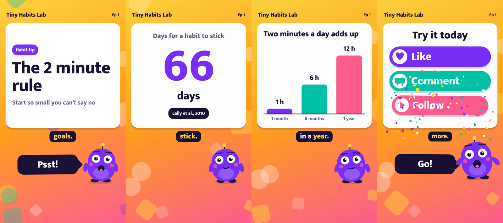

# video-skills

Two Claude skills that turn an idea into a narrated vertical video. You describe the video, Claude writes the script, ElevenLabs speaks it, and Remotion or Revideo renders a 1080x1920 MP4 for Shorts, Reels or TikTok.



Both skills ship the same starter video, built two ways:

- Five scene types: a hook card, a numbered list, a big number that counts up, a bar chart, and a call to action.
- Every visual lands on the word that's being spoken. ElevenLabs returns a timestamp for each character, and the kit turns that into a time for every word.
- Word-by-word captions, with the current word highlighted.
- A mascot that lip-syncs from the word timings, blinks, and cheers at the end.
- Colours, channel name, footer, captions and mascot are all set in one JSON file.

| Skill | Engine | Pick it when |
|---|---|---|
| `remotion-video` | [Remotion](https://www.remotion.dev) 4 (React, HTML and CSS) | You want normal web layout, a preview studio with hot reload, and good docs |
| `revideo-video` | [Revideo](https://github.com/midrender/revideo) 0.11 (canvas, generators) | You want speed and an MIT licence, and can live with a pre-1.0 library |

## How the two compare

Measured on the example video (25 seconds, 752 frames) on an Apple M2 with 8 GB RAM.

| | Remotion | Revideo |
|---|---|---|
| Full render | 26.5 s | 8 to 10 s (6.2 s with two workers) |
| Output size | 4.9 MB | 11 MB |
| Check one moment | `remotion still`, about 4 s | Render a 4 s range, about 2 s |
| Licence | Free for individuals and companies of up to 3 people. Larger companies pay. | MIT |
| Disk | About 950 MB in `node_modules` after the first render | About 310 MB, plus 575 MB of Chrome in `~/.cache/puppeteer` |
| Telemetry | Not checked | On by default. The kit turns it off for renders. |
| Layout | HTML and CSS, text wraps by itself | Canvas only. The kit measures and wraps text for you. |

My pick: start with Remotion if its licence fits you, because fixing a layout in HTML is quicker. Move to Revideo when you render a lot of videos or need the MIT licence.

## What you need

- Node (tested on 24), Python 3, and ffmpeg on your PATH.
- An [ElevenLabs](https://elevenlabs.io) API key. The example video is 401 characters. There is no free or silent mode: the timings come from the voice.

## Install (Claude Code)

```bash
git clone https://github.com/anujkapoor-arch/video-skills
cd video-skills
./install.sh
```

This copies both skills, each with its own copy of the kit, into `~/.claude/skills/`. Then, in any session:

```
/remotion-video a 30 second short on three ways to remember people's names, for my channel "Small Talk"
```

Claude writes the script, shows you the lines and the character count before it spends anything on voice, renders, and checks frames before handing you the file.

## Use it without Claude

The kit is a normal project generator.

```bash
./kit/new-video.sh remotion ~/videos/my-first-short     # or: revideo
cd ~/videos/my-first-short
npm install
export ELEVENLABS_API_KEY=...        # or put it in a .env file here
# edit script.json
python3 narrate.py --check           # validate, count characters, no API call
python3 narrate.py                   # voice + timings
npm run render                       # -> out/video.mp4
```

`script.json` is the only file you have to write. Every field is described in [kit/common/SCRIPT.md](kit/common/SCRIPT.md). A scene looks like this:

```json
{
  "kind": "points",
  "say": "Shrink the habit until it takes two minutes. Do it at the same time every day. Then stop while it still feels easy.",
  "title": "How it works",
  "items": [
    {"text": "Shrink it to two minutes", "at": "shrink"},
    {"text": "Same time every day", "at": "same"},
    {"text": "Stop while it's easy", "at": "stop"}
  ]
}
```

`at` is the spoken word each row appears on.

## What's in the repo

```
skills/remotion-video/SKILL.md   instructions Claude follows for Remotion
skills/revideo-video/SKILL.md    instructions Claude follows for Revideo
kit/new-video.sh                 creates a project from the kit
kit/common/narrate.py            script.json -> narration.wav + spec.json (ElevenLabs, cached)
kit/common/SCRIPT.md             every script.json field
kit/common/script.json           the example script
kit/common/fonts/                Mukta, three weights
kit/remotion/                    the Remotion starter
kit/revideo/                     the Revideo starter
```

## What we learned the hard way

The skills carry these so Claude doesn't repeat them. The short list:

Remotion
- Everything is a function of the frame. Anything with memory (state, CSS transitions, `Math.random()`) breaks, because frames render in parallel and out of order.
- Hold the render with `delayRender` until fonts load.
- An SVG character has to be ported to JSX by hand before you can move its parts.

Revideo
- A `<Txt>` whose text is a function renders nothing. Set the text by hand.
- The `<SVG>` node flattens groups and drops ids. Draw the character from shapes.
- Browser errors print as `JSHandle@object`. `VITE_DEBUG_LOGS=1` turns them into text.
- There are no docs in the npm packages. We read the type files.

Both
- Take every time from the narration, never from a number typed into the code. Change a line of the script and the video re-times itself.
- Check single frames before a full render. Most problems are visible in one frame.

## Limits

- 1080x1920 only. Another size means editing the layout code.
- The font is Mukta (Latin and Devanagari). Other scripts need another font.
- Nobody has tested the Revideo editor (`npm start`) with this kit.
- Revideo prints one "asynchronous property" warning per render. The output is correct.
- Claude can check frames. It can't hear the voice or watch motion, so watch the video once yourself.

## Licence

MIT for everything in this repo. The Mukta font is under the SIL Open Font License ([kit/common/fonts/OFL.txt](kit/common/fonts/OFL.txt)). Remotion has its own licence: read it at [remotion.dev/docs/license](https://www.remotion.dev/docs/license) before using it at a company with more than 3 people.
